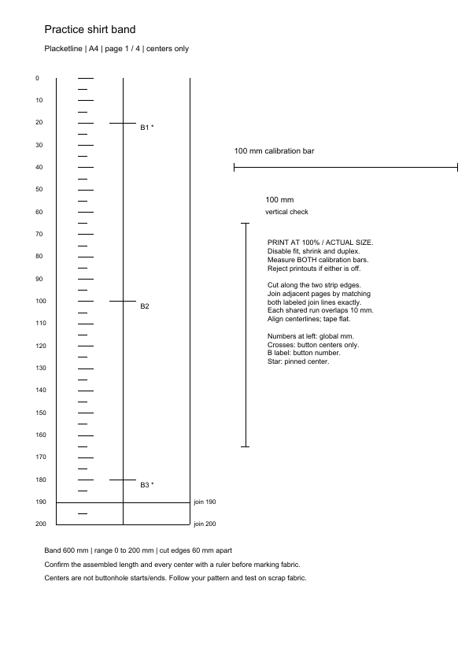

# Placketline

**Keep the important marks. Space the rest.**

[Open Placketline](https://placketline.vercel.app)

Placketline plans button **centers** around multiple fixed positions and produces calibrated, tiled PDF marking strips. Every center is measured from one top edge, so you can check the complete layout before transferring marks.

- Fix the first and last centers, then pin any interior button numbers.
- Space centers evenly within each pinned section.
- Inspect all positions from both edges, plus exact section-gap fractions.
- Download A4 or US Letter strips with two-axis calibration and 10 mm registration runs.
- Export the complete CSV, exact receipt or portable project JSON.
- Work locally in one tab: no accounts, uploads, analytics, browser storage or runtime dependencies.

## Actual output preview



This is an actual exported PDF page rendered with Poppler, not a screenshot of the application. The picture is a reduced preview; print the PDF at actual size.

[Example A4 PDF](examples/marking-a4.pdf) · [Letter PDF](examples/marking-letter.pdf) · [Position CSV](examples/positions.csv) · [Exact receipt](examples/receipt.json)

## Use the planner

1. Measure the finished band and enter millimeters, with up to two decimal places.
2. Choose 2–50 centers and enter the first and last positions **from the top**, not offsets from different edges.
3. Optionally list fixed interior centers: `3, 180` means button 3 stays at 180 mm. List pins in increasing button and position order.
4. Select paper, plan the centers and inspect every section. Different sections can have different spacings.
5. Download the PDF or table. Editing inputs locks exports until a valid new plan is calculated.
6. Save project JSON to continue later; the exact receipt is for inspection, not project import.

The example uses a 600 mm band with eight buttons: endpoints 20 and 580 mm, button 3 at 180 mm and button 6 at 440 mm.

| Button | From top, mm | Position |
| --- | ---: | --- |
| 1 | 20 | Pinned |
| 2 | 100 | Spaced |
| 3 | 180 | Pinned |
| 4 | 266.667 | Spaced |
| 5 | 353.333 | Spaced |
| 6 | 440 | Pinned |
| 7 | 510 | Spaced |
| 8 | 580 | Pinned |

The middle section has an exact gap of **260/3 mm**, not 86.667 mm reused repeatedly. Rounding individual display values never feeds back into the plan.

## Print and join

- Print on the chosen paper at **100% / Actual size**. Disable fitting, shrinking and duplex.
- Measure **both** 100 mm calibration bars with a real ruler. Reject wrong or clipped bars.
- Cut along the two vertical strip edges. Each strip is 60 mm wide.
- Match both labeled join lines and the centerline on adjacent pages. Overlap the shared 10 mm run, rather than joining page edges.
- Check the assembled band length and every center against the table and actual garment before marking fabric.

PDF pages cover up to 200 mm, starting every 190 mm. The last page stops at the band end. A center inside an overlap appears on both pages intentionally. Ruler labels use global millimeters, not page-relative distances.

## Setup

Node.js 22 or 24:

```sh
npm ci --ignore-scripts --no-audit --no-fund
npm test
npm run example
npm run build
npm run dev
```

Open the address printed by the local server, normally `http://127.0.0.1:4225`. The site serves from `dist/`. Only JSDOM is needed for development tests; the production app has no package dependencies.

## Deploy on Vercel

Import the repository, choose **Other**, leave the root directory empty, use `npm run build` and output directory `dist`, and set Node.js 24. The install command is empty because the static build uses Node's standard library. The checked-in `vercel.json` includes these settings and restrictive response headers. No environment variables or backend are needed.

## Method and verification

For each adjacent anchor pair, the gap is the position difference divided by the button-number difference. Positions use reduced BigInt fractions derived from hundredth-millimeter input. A separate audit checks count, order, endpoint and interior pin preservation, equal gaps within each section, reverse-edge positions and tile coverage.

`npm test` runs 29 checks, including 4,617 single-anchor layouts verified using independent cross-multiplied equations, all 2,000 supported integer band lengths for coverage/overlap, exact examples, 50-center exports, A4/Letter PDF media and cross-reference offsets, actual calibration-line lengths, committed PDF byte integrity, import races, stale exports and local Blob contents. CI runs tests and the static build on Windows and Linux with Node 22 and 24.

The example PDFs were rendered and inspected. Automated DOM checks do not establish native browser layout, screen-reader behavior, print-driver accuracy or physical sewing results.

## Boundaries

- **Centers only:** not buttonhole starts/ends, stitch guides or machine-foot alignment.
- Millimeters only; length 1–2000 mm; 2–50 buttons; strictly ordered endpoints and pins.
- No automatic button count, body measurements, garment fit, gaping prevention, buttonhole length or fabric-strength assessment. Follow your pattern and test on scrap.
- Cannot repair cut holes or infer missing measurements from photos.
- Exact fractions are in JSON and CSV; displayed decimals round half-up to 0.001 mm. Import CSV fractions as text to avoid spreadsheet date conversion.
- PDF coordinates round to 0.000001 points. Your printer, paper, ruler and joining technique determine physical accuracy.
- If any gap is below 5 mm, PDF button-number labels are suppressed. All crosses remain, and at very small gaps they overlap; use the complete table.
- Titles accept 1–60 printable ASCII characters for reliable standard PDF-font output. Project JSON is limited to 20,000 UTF-8 bytes.
- No automatic saving. Keep downloaded project files and confirm imports before use.
- Static hosting receives ordinary page requests; project measurements are not sent by the app.

MIT licensed.
